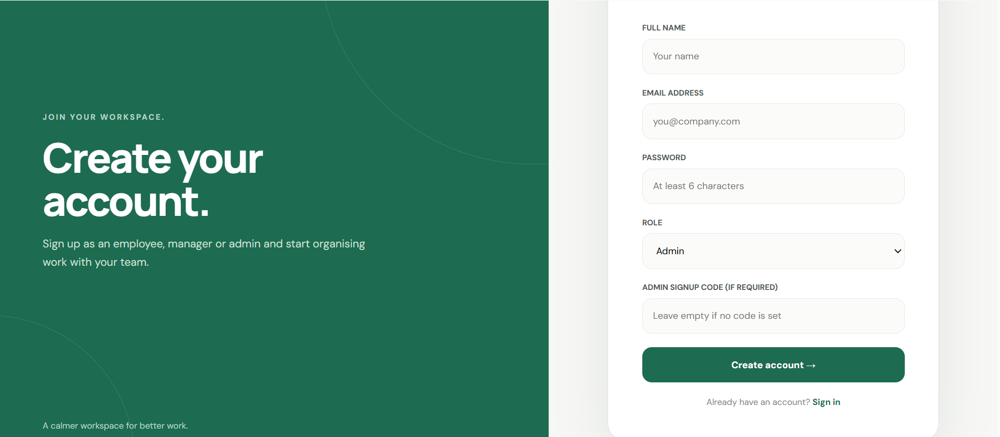
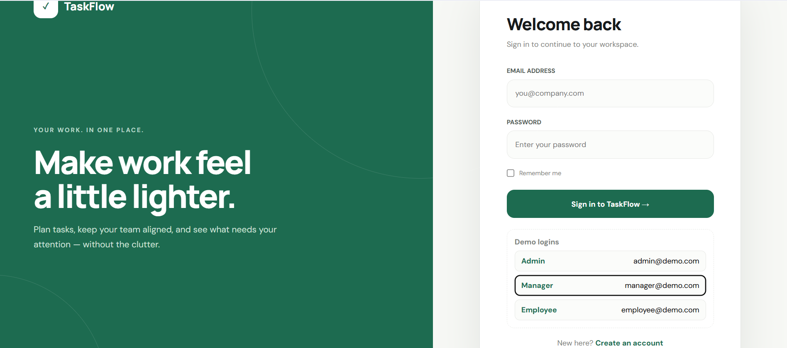
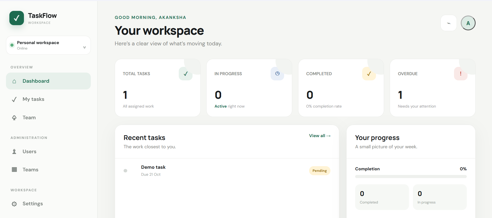
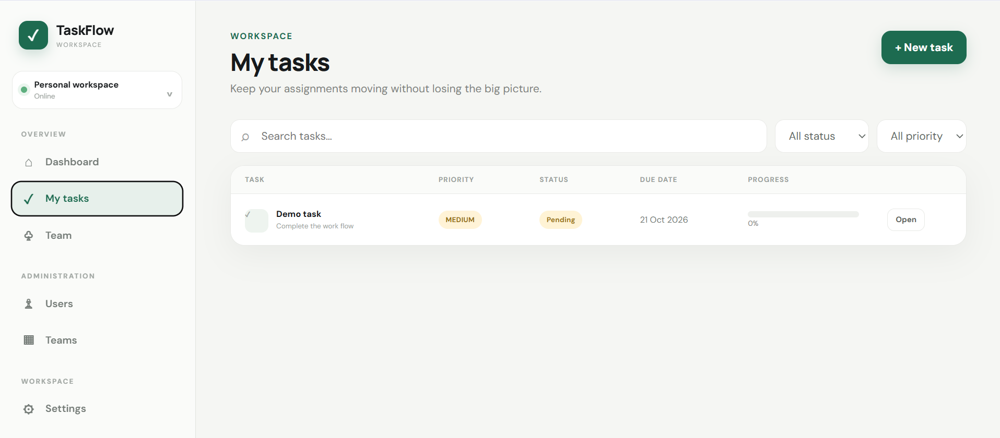
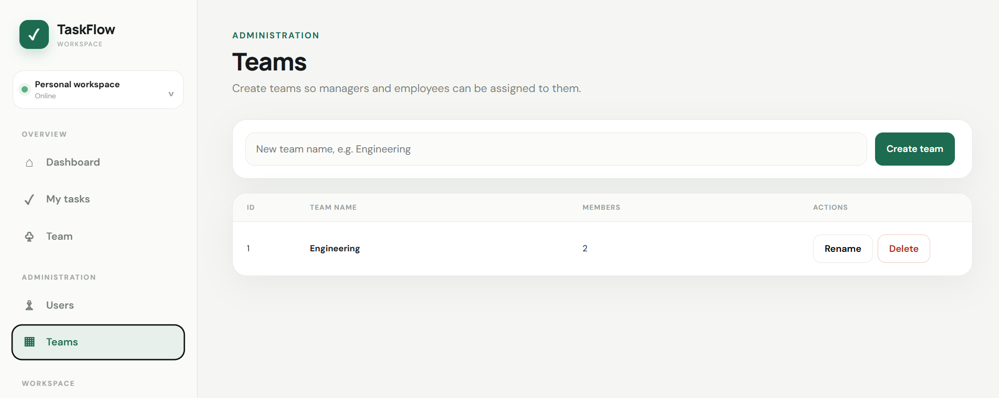
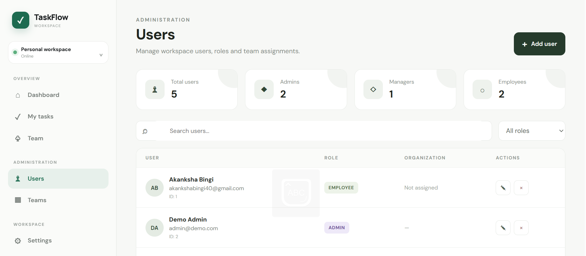
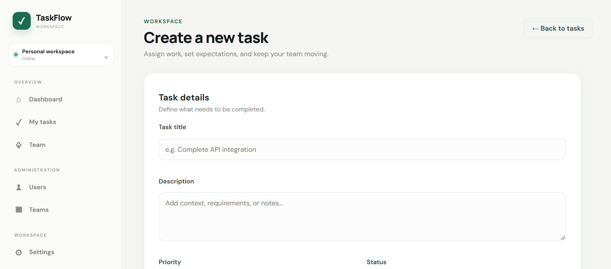
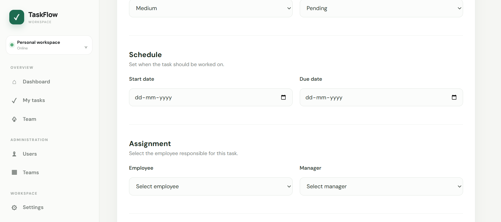
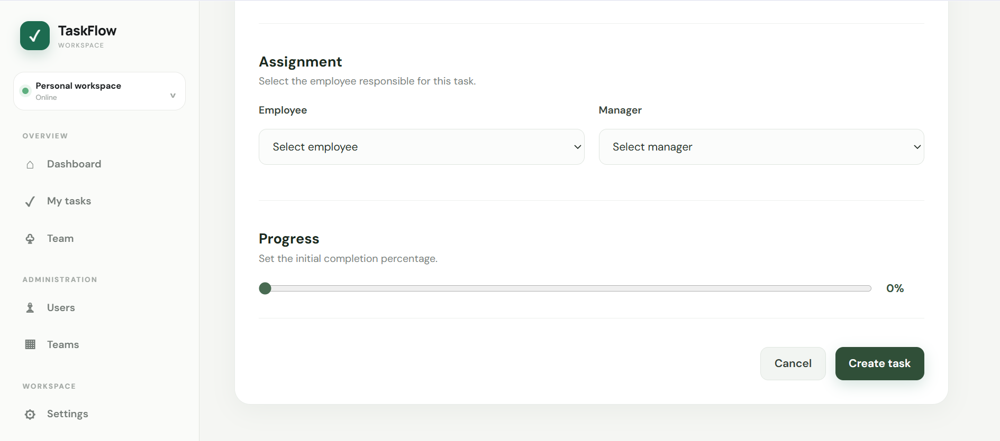

# Employee Task Management (TaskFlow)

A full-stack task management app for teams. Admins manage users and teams, managers assign tasks to their employees, and employees track and update their own work. The backend is a Spring Boot REST API secured with JWT, and the frontend is a Vue 3 single-page app.

## Live Demo

🔗 **[Open the app] https://employee-task-management-kdl4.onrender.com/login**

> **Note:** The backend is deployed on Render and the database is hosted on Aiven, both on free tiers. When the app has been idle, the services may be asleep or switched off. The first request can take a minute or so to wake them, and if the database has been paused the app may show errors until it's back. If the demo doesn't load, wait a minute and refresh, or check the screenshots below.

## Features

- **Role-based access** for three roles: Admin, Manager and Employee
- **JWT authentication**: login and public signup, BCrypt-hashed passwords, stateless sessions
- **Task management**: title, description, priority, status, progress, start and end dates, assigned employee and manager
- **Team management**: teams, members, and manager-to-employee assignment
- **Validation and rules**: an employee must be in the same team as their manager, a manager with employees can't be deleted, and a task title is unique per employee
- **Dashboard and views**: dashboard, task list and details, team views, user management, profile and settings
- Dockerised backend, deployed on Render with a MySQL database on Aiven
- Admin signup code (demo only): TM-9xK2-pQ7w. Enter it on the signup page to create an Admin account and explore everything.

## Screenshots













## Tech Stack

| Layer | Technology |
|-------|-----------|
| Backend | Java 25, Spring Boot 4.1, Spring Web MVC, Spring Data JPA (Hibernate), Spring Security |
| Auth | JWT (jjwt 0.12), BCrypt |
| Database | MySQL (Aiven in production) |
| Frontend | Vue 3, Vue Router, Axios, Vite |
| Build / deploy | Maven (wrapper included), Docker, Render |

## Roles and Permissions

| Role | What they can do |
|------|------------------|
| **Admin** | Manage all users and teams, create and update any task, delete tasks, see everything |
| **Manager** | Create and update tasks for their own employees, view their team and employees |
| **Employee** | View their own tasks and update them within limited fields |

Only admins can create, update or delete users and teams, and only admins can delete tasks. These rules are enforced in the backend, not just hidden in the UI.

## Getting Started

### Prerequisites

- Java 25
- Node.js 20 or newer (for the frontend)
- MySQL 8 (a local install, a Docker container or a hosted database)

### 1. Create a database

Using Docker:

```bash
docker run -d --name etm-mysql \
  -e MYSQL_ROOT_PASSWORD=change-me \
  -e MYSQL_DATABASE=employee_task_management \
  -p 3306:3306 mysql:8.4
```

Tables are created automatically on first start (`spring.jpa.hibernate.ddl-auto=update`).

### 2. Configure the backend

The backend reads its settings from environment variables:

| Variable | Required | Description |
|----------|----------|-------------|
| `DB_URL` | yes | JDBC URL, e.g. `jdbc:mysql://localhost:3306/employee_task_management` |
| `DB_USERNAME` | yes | Database user |
| `DB_PASSWORD` | yes | Database password |
| `JWT_SECRET` | yes | Signing key. **Must be at least 32 characters**, otherwise token creation fails |
| `ADMIN_SIGNUP_CODE` | yes | Code that must be entered to sign up as an Admin. Admin signup is disabled if unset |

Never commit your real values.

### 3. Run the backend

Mac/Linux/Git Bash:

```bash
export DB_URL="jdbc:mysql://localhost:3306/employee_task_management"
export DB_USERNAME=root
export DB_PASSWORD=change-me
export JWT_SECRET="replace-with-a-long-random-string-of-32+chars"
export ADMIN_SIGNUP_CODE="choose-a-code"
./mvnw spring-boot:run
```

On Windows PowerShell, set variables with `$env:DB_URL="..."` and run `.\mvnw spring-boot:run`.

The API runs at `http://localhost:8080`.

### 4. Run the frontend

```bash
cd frontend
npm install
npm run dev
```

The app opens at `http://localhost:5173`. It calls `http://localhost:8080` by default. To point it at another backend, set the `VITE_API_URL` environment variable (for example in `frontend/.env`).

### Run with Docker (backend only)

```bash
docker build -t employee-task-management .
docker run -p 8080:8080 \
  -e DB_URL="jdbc:mysql://host.docker.internal:3306/employee_task_management" \
  -e DB_USERNAME=root -e DB_PASSWORD=change-me \
  -e JWT_SECRET="replace-with-a-long-random-string-of-32+chars" \
  -e ADMIN_SIGNUP_CODE="choose-a-code" \
  employee-task-management
```

## API Overview

All endpoints except `/auth/**` require the header `Authorization: Bearer <token>`. Tokens last 1 hour.

| Method | Endpoint | Access |
|--------|----------|--------|
| POST | `/auth/login` | Public |
| POST | `/auth/signup` | Public (Admin signup needs the admin code) |
| GET | `/auth/teams`, `/auth/managers` | Public, used by the signup form |
| GET | `/users` | Admin |
| POST, PUT, DELETE | `/users`, `/users/{id}` | Admin |
| GET | `/users/{id}`, `/users/{id}/tasks` | Admin, the user themselves, or their manager |
| GET | `/users/{id}/employees` | Admin or that manager |
| GET | `/teams`, `/teams/{id}`, `/teams/{id}/users` | Any logged-in user |
| POST, PUT, DELETE | `/teams`, `/teams/{id}` | Admin |
| GET | `/tasks`, `/tasks/{id}` | Logged in; results are limited to what the role may see |
| POST | `/tasks` | Admin, Manager |
| PUT | `/tasks/{id}` | Admin, the task's manager, or the assigned employee (limited fields) |
| DELETE | `/tasks/{id}` | Admin |

Example login:

```bash
curl -X POST http://localhost:8080/auth/login \
  -H "Content-Type: application/json" \
  -d '{"email":"you@example.com","password":"your-password"}'
```

Response:

```json
{ "token": "<jwt>", "user": { "id": 1, "name": "...", "email": "...", "role": "ADMIN" } }
```

Errors are returned as `{ "message": "..." }` with these statuses: 400 (validation), 401 (bad credentials or token), 403 (not allowed), 404 (not found), 409 (conflict, such as a duplicate email).

## Project Structure

```
.
├── src/main/java/com/akanksha/employee_task_management/
│   ├── config/        # SecurityConfig (CORS, route rules, BCrypt)
│   ├── controller/    # Auth, User, Team, Task controllers
│   ├── service/       # Business rules (User, Team, Task)
│   ├── repository/    # Spring Data JPA repositories
│   ├── entity/        # User, Team, Task
│   ├── dto/           # Request and response objects
│   ├── security/      # JwtService, JwtAuthenticationFilter
│   └── exception/     # Custom exceptions + GlobalExceptionHandler
├── frontend/          # Vue 3 + Vite app (views, router, API service)
├── docs/screenshots/  # README images
├── Dockerfile         # Backend image
└── pom.xml
```

## Deployment Notes

The backend runs on Render as a Docker service, with a MySQL database hosted on Aiven:

- Set `DB_URL`, `DB_USERNAME`, `DB_PASSWORD`, `JWT_SECRET` and `ADMIN_SIGNUP_CODE` as environment variables.
- Allowed browser origins are configured in `SecurityConfig` (CORS). Add your frontend URL there.
- Build the frontend with `VITE_API_URL` set to the backend's public URL.
- Free-tier services can sleep or pause when idle, so the first request after a quiet period may be slow or fail until they wake up.

## Possible Improvements

- Automated tests beyond the default context-load test
- Database migrations (Flyway) instead of `ddl-auto=update`
- Pagination and filtering on task and user lists
- Refresh tokens and re-checking the user's role on each request

## Author

[akankshabingii](https://github.com/akankshabingii)